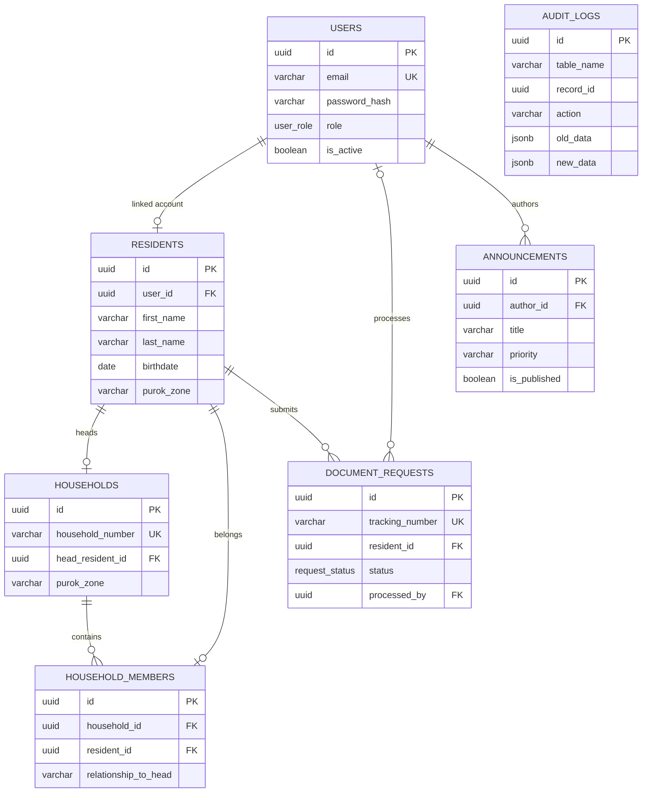

# Barangay Link — Database Documentation

**Document Type:** Database Technical Documentation  
**System:** Barangay Link  
**Database Management System:** PostgreSQL  
**Database Schema:** `barangay`  
**Prepared by:** Database Designer  
**Purpose:** To document the database structure, relationships, constraints, functions, stored procedures, triggers, and implementation guidelines of the Barangay Link system.

---

## 1. Overview

The Barangay Link database is designed to store and manage the information needed for the barangay's digital services. It serves as the central storage for user accounts, resident profiles, household information, document requests, announcements, and system audit records.

The database uses PostgreSQL to organize information into related tables. Primary keys uniquely identify records, foreign keys connect related records, and constraints help maintain data consistency.

The database also uses PostgreSQL functions, stored procedures, and triggers to automate selected operations, update timestamps, generate document tracking numbers, calculate resident ages, retrieve dashboard statistics, and record changes to document request statuses.

## 2. Database Objectives

The database is designed to:

- Store and organize resident information.
- Manage user accounts and system roles.
- Record households and their members.
- Track barangay document requests from submission to release.
- Store announcements published by authorized users.
- Maintain audit records for document request status changes.
- Support dashboard analytics for residents, households, and document requests.
- Maintain relationships and data integrity through database constraints.

## 3. Technologies Used

| Technology | Purpose |
|---|---|
| PostgreSQL | Relational database management system |
| SQL | Database definition and data manipulation |
| PL/pgSQL | Programming language for database functions and procedures |
| UUID | Unique identifiers for database records |
| JSONB | Structured storage of old and new values in audit records |
| `uuid-ossp` extension | Generates UUID values using `uuid_generate_v4()` |

## 4. Database Schema

The database uses a schema named `barangay`.

```sql
CREATE EXTENSION IF NOT EXISTS "uuid-ossp";
CREATE SCHEMA IF NOT EXISTS barangay;

SET search_path TO barangay, public;
```

**Explanation:**

- `CREATE EXTENSION` enables UUID generation functions.
- `CREATE SCHEMA` creates the logical namespace for the barangay database objects.
- `SET search_path` tells PostgreSQL to look in the `barangay` schema first, followed by `public`, when resolving unqualified database object names.

The use of a separate schema helps organize database objects and reduces the risk of naming conflicts with other application components.

## 5. Database Tables

The database contains seven main tables.

### 5.1 `users`

**Purpose:** Stores user account information used for authentication and role-based access.

| Column | Data Type | Description |
|---|---|---|
| `id` | UUID | Primary key and unique user identifier |
| `email` | VARCHAR(150) | User's unique email address |
| `password_hash` | VARCHAR(255) | Stored password hash |
| `role` | `user_role` | User's assigned system role |
| `is_active` | BOOLEAN | Indicates whether the account is active |
| `created_at` | TIMESTAMPTZ | Date and time the account was created |
| `updated_at` | TIMESTAMPTZ | Date and time the account was last updated |

**Defined roles:**
- Administrator
- Barangay Staff
- Resident

The default role is `Resident`. The `email` column must be unique, and the password must be stored as a secure hash rather than as plain text.

### 5.2 `residents`

**Purpose:** Stores the personal and contact information of barangay residents.

| Column | Data Type | Description |
|---|---|---|
| `id` | UUID | Primary key and unique resident identifier |
| `user_id` | UUID | Optional link to a user account |
| `first_name` | VARCHAR(100) | Resident's first name |
| `middle_name` | VARCHAR(100) | Resident's middle name |
| `last_name` | VARCHAR(100) | Resident's last name |
| `suffix` | VARCHAR(20) | Name suffix, if applicable |
| `birthdate` | DATE | Resident's birthdate |
| `gender` | VARCHAR(10) | Gender value restricted by a CHECK constraint |
| `civil_status` | `civil_status` | Resident's civil status |
| `purok_zone` | VARCHAR(100) | Resident's purok or zone |
| `address_line` | TEXT | Detailed residential address |
| `contact_number` | VARCHAR(20) | Resident's contact number |
| `is_archived` | BOOLEAN | Indicates whether the resident record is archived |
| `created_at` | TIMESTAMPTZ | Record creation timestamp |
| `updated_at` | TIMESTAMPTZ | Last record update timestamp |

**Important constraints:**
- Each resident must have a first name, last name, birthdate, purok or zone, and address.
- `user_id` is unique, allowing a user account to be linked to at most one resident record.
- Gender is restricted to `Male`, `Female`, or `Other`.
- Civil status uses the predefined `civil_status` ENUM.
- Archiving a resident does not automatically delete their record.

### 5.3 `households`

**Purpose:** Stores household records and identifies the head of each household.

| Column | Data Type | Description |
|---|---|---|
| `id` | UUID | Primary key |
| `household_number` | VARCHAR(50) | Unique household number |
| `head_resident_id` | UUID | Resident designated as the household head |
| `purok_zone` | VARCHAR(100) | Household's purok or zone |
| `created_at` | TIMESTAMPTZ | Record creation timestamp |
| `updated_at` | TIMESTAMPTZ | Last record update timestamp |

**Important constraints:**
- Each household must have a unique household number.
- The household head must reference an existing resident.
- `head_resident_id` is unique, so a resident cannot be assigned as the head of multiple households through this column.
- `ON DELETE RESTRICT` prevents deleting a resident who is still referenced as a household head.

### 5.4 `household_members`

**Purpose:** Connects residents to households and records their relationship to the household head.

| Column | Data Type | Description |
|---|---|---|
| `id` | UUID | Primary key |
| `household_id` | UUID | Reference to the household |
| `resident_id` | UUID | Reference to the resident |
| `relationship_to_head` | VARCHAR(50) | Relationship to the household head |
| `created_at` | TIMESTAMPTZ | Record creation timestamp |

This table resolves the relationship between households and residents.

**Important constraints:**
- `household_id` references `households.id`.
- `resident_id` references `residents.id`.
- Each resident can appear only once in this table because `resident_id` is unique.
- Deleting a household removes its associated household-member records through `ON DELETE CASCADE`.
- Deleting a resident also removes their household-member record through `ON DELETE CASCADE`.

### 5.5 `document_requests`

**Purpose:** Stores residents' requests for barangay documents and tracks their processing status.

| Column | Data Type | Description |
|---|---|---|
| `id` | UUID | Primary key |
| `tracking_number` | VARCHAR(30) | Unique request tracking number |
| `resident_id` | UUID | Resident who submitted the request |
| `document_type` | VARCHAR(100) | Type of document requested |
| `purpose` | TEXT | Reason for requesting the document |
| `status` | `request_status` | Current request status |
| `remarks` | TEXT | Additional processing notes |
| `processed_by` | UUID | User account associated with processing |
| `created_at` | TIMESTAMPTZ | Request creation timestamp |
| `updated_at` | TIMESTAMPTZ | Last request update timestamp |

**Supported request statuses:**
- Pending
- Approved
- Rejected
- Ready for Release
- Released

The `resident_id` foreign key prevents deleting a resident who has document requests. The `processed_by` field references a user account and becomes `NULL` if that account is deleted.

The tracking number is unique, allowing each request to be identified individually.

### 5.6 `announcements`

**Purpose:** Stores announcements created by authorized users.

| Column | Data Type | Description |
|---|---|---|
| `id` | UUID | Primary key |
| `author_id` | UUID | User who created the announcement |
| `title` | VARCHAR(255) | Announcement title |
| `content` | TEXT | Announcement body |
| `priority` | VARCHAR(20) | Announcement priority |
| `is_published` | BOOLEAN | Indicates whether the announcement is published |
| `created_at` | TIMESTAMPTZ | Announcement creation timestamp |
| `updated_at` | TIMESTAMPTZ | Last announcement update timestamp |

**Supported priorities:** `Low`, `Normal`, `High`, and `Urgent`.

The `author_id` field references the `users` table. The `is_published` field allows announcements to be marked as unpublished without deleting them.

### 5.7 `audit_logs`

**Purpose:** Stores audit records for document request status changes.

| Column | Data Type | Description |
|---|---|---|
| `id` | UUID | Primary key |
| `table_name` | VARCHAR(50) | Name of the affected table |
| `record_id` | UUID | Identifier of the affected record |
| `action` | VARCHAR(20) | Type of recorded action |
| `performed_by` | VARCHAR(100) | Database user recorded as performing the action |
| `old_data` | JSONB | Selected values before the change |
| `new_data` | JSONB | Selected values after the change |
| `timestamp` | TIMESTAMPTZ | Time the audit record was created |

The audit log is designed to provide a history of document request status changes. The trigger currently records the previous status and remarks, as well as the new status, processor identifier, and remarks.

**Note:** The current implementation records the PostgreSQL database identity through `CURRENT_USER`. It does not automatically identify the individual application user who initiated the request.

## 6. Database Relationships

The database uses primary keys and foreign keys to connect related records.

| Relationship | Type | Explanation |
|---|---|---|
| `users` → `residents` | One-to-zero-or-one | A user account can be linked to at most one resident record. A resident may also have no linked user account. |
| `residents` → `households` | One-to-many in principle, constrained by uniqueness | A resident may be referenced as a household head, but `head_resident_id` uniqueness limits the resident to one household as its head. |
| `households` → `household_members` | One-to-many | A household can contain multiple membership records. |
| `residents` → `household_members` | One-to-zero-or-one | A resident can have at most one membership record under the current unique constraint. |
| `residents` → `document_requests` | One-to-many | A resident may submit multiple document requests. |
| `users` → `document_requests` | One-to-many in principle | A user may process multiple requests. Each request can reference at most one processor. |
| `users` → `announcements` | One-to-many | A user may author multiple announcements. |

### Relationship diagram



The diagram describes the principal relationships. The actual foreign-key constraints and uniqueness rules in the SQL determine which records may be created.

## 7. ENUM Types

The database defines three ENUM types to standardize values.

| ENUM Type | Allowed Values | Purpose |
|---|---|---|
| `user_role` | Administrator, Barangay Staff, Resident | Defines account roles |
| `request_status` | Pending, Approved, Rejected, Ready for Release, Released | Defines document request statuses |
| `civil_status` | Single, Married, Widowed, Divorced, Separated | Defines civil status values |

ENUM types prevent unsupported values from being inserted into the corresponding columns. Adding a new option requires a database schema change.

## 8. Database Indexes

Indexes are created to improve the performance of frequently used searches.

| Index | Table and Columns | Purpose |
|---|---|---|
| `idx_residents_name` | `residents(last_name, first_name)` | Supports searches and sorting by resident name |
| `idx_residents_purok` | `residents(purok_zone)` | Supports filtering residents by purok or zone |
| `idx_doc_requests_status` | `document_requests(status)` | Supports filtering requests by status |
| `idx_doc_requests_tracking` | `document_requests(tracking_number)` | Supports tracking-number searches |

Primary keys and unique constraints also create supporting indexes in PostgreSQL. Additional indexes should be added only when justified by actual query patterns and performance needs.

## 9. Database Triggers

Triggers execute automatically when specified database events occur.

### 9.1 Timestamp Update Trigger

**Function:** `fn_update_timestamp()`

This function automatically updates the `updated_at` column to the current timestamp whenever a row is updated.

**Triggers using this function:**
- `trg_users_updated_at`
- `trg_residents_updated_at`
- `trg_households_updated_at`
- `trg_doc_requests_updated_at`
- `trg_announcements_updated_at`

**Purpose:** To keep the last-modified timestamp consistent without requiring the application to set it manually.

**Implementation note:** The current SQL does not attach this trigger to `household_members` or `audit_logs`. The `household_members` table also has no `updated_at` column.

### 9.2 Document Request Audit Trigger

**Function:** `fn_audit_document_requests()`

**Trigger:** `trg_audit_document_status`

This is an `AFTER UPDATE` trigger on `document_requests`.

**Process:**

1. A document request is updated.
2. The trigger checks whether the request status changed.
3. If the status changed, an audit record is inserted into `audit_logs`.
4. The audit record stores the old and new status-related information.
5. If the status did not change, this trigger does not insert an audit record.

**Purpose:** To maintain a history of document request status changes for monitoring and accountability.

The current trigger records status changes only. It does not audit every insert, deletion, or modification to every database table.

## 10. Database Functions

### 10.1 `fn_calculate_age(p_birthdate DATE)`

**Return type:** `INT`

**Purpose:** Calculates a person's age using their birthdate and the current date.

**Logic:**
1. Accepts a birthdate as input.
2. Uses PostgreSQL's `AGE()` function to calculate the difference between the current date and birthdate.
3. Extracts the year component and returns it as an integer.

**Example use:**

```sql
SELECT barangay.fn_calculate_age('2004-05-15');
```

The returned age depends on the date the function is executed.

**Technical note:** Because this function uses `CURRENT_DATE`, it should normally be declared `STABLE`, not `IMMUTABLE`. Its result can change as the current date changes even when the input birthdate remains the same.

### 10.2 `fn_generate_tracking_number()`

**Return type:** `VARCHAR`

**Purpose:** Generates a tracking number for a document request.

**Format:**

`BRGY-YYYYMM-NNNN`

Example format: `BRGY-202610-0001`

**Logic:**
1. Creates a prefix using the current year and month.
2. Counts existing document requests with that prefix.
3. Adds one to the count.
4. Pads the sequence number to four digits.
5. Returns the complete tracking number.

**Important implementation note:** The function currently calculates the next number using `COUNT(*) + 1`. Concurrent requests may calculate the same number, and deleted records can affect the next value. A database sequence or another concurrency-safe allocation method is recommended before production use. The unique constraint on `tracking_number` helps reject duplicate values but does not prevent allocation conflicts.

## 11. Stored Procedures

### 11.1 `sp_register_resident_user(...)`

**Purpose:** Registers a new user account and its associated resident profile.

**Inputs include:**
- Email
- Password hash
- First, middle, and last names
- Birthdate
- Gender
- Purok or zone
- Address
- Contact number

**Outputs:**
- `p_user_id`
- `p_resident_id`

**Process:**
1. Inserts the account into `users` with the `Resident` role.
2. Retrieves the newly generated user UUID.
3. Inserts the resident's personal information into `residents`.
4. Links the resident profile to the account using `user_id`.
5. Returns the generated user and resident identifiers through the `INOUT` parameters.

Both inserts execute within the procedure call's transaction context when called normally as a single statement. If an error causes the statement to fail, both changes are rolled back.

### 11.2 `sp_update_request_status(...)`

**Purpose:** Updates a document request's status and processing information.

**Parameters:**
- `p_request_id`: UUID of the document request
- `p_new_status`: New request status
- `p_processed_by`: UUID of the user processing the request
- `p_remarks`: Processing remarks

**Process:**
1. Checks whether the specified request exists.
2. Raises an exception if the request cannot be found.
3. Updates the request status.
4. Records the processor identifier.
5. Updates remarks when new remarks are supplied.
6. Updates the modification timestamp.
7. Activates the audit trigger if the status changes.

**Important note:** The procedure checks whether the request exists, but it does not currently validate whether the requested status transition is allowed or whether the processor has the correct application role. Those rules should be enforced by the application and, where appropriate, by additional database logic.

## 12. Dashboard Analytics Function

**Function:** `fn_get_dashboard_analytics()`

**Return type:** A table containing five counts.

| Returned Column | Description |
|---|---|
| `total_residents` | Number of residents whose records are not archived |
| `total_households` | Total number of household records |
| `pending_requests` | Number of requests with `Pending` status |
| `approved_requests` | Number of requests with `Approved` status |
| `released_requests` | Number of requests with `Released` status |

**Example use:**

```sql
SELECT *
FROM barangay.fn_get_dashboard_analytics();
```

**Purpose:** Provides summarized data for the system dashboard without requiring the application to write five separate counting queries.

The function returns the current counts when called. Archived residents are excluded from the resident total, while the household and request counts follow the stated SQL conditions.

## 13. Default Data and Initial Account Setup

The supplied SQL includes an initial user record:

- Email: `staff@barangaylink.gov`
- Role: `Barangay Staff`
- Password storage: A bcrypt-formatted hash

This record is intended to provide an initial staff account for testing or system initialization.

**Security requirements:**
- Never commit plaintext database passwords, production credentials, or private secrets to GitHub.
- Do not publish real resident information or production database dumps.
- Use environment variables or a secure secret-management mechanism for database credentials.
- Verify the initial account's ownership and intended use before deployment.
- Replace or disable initial credentials before production use.

The supplied SQL also includes a PostgreSQL administrator password change. That command should not be included in a shared schema migration or a public repository. If the password has already been exposed in a shared repository, rotate it and review the database's access permissions.

## 14. SQL File Organization

The supplied SQL is divided into three logical sections.

| File | Contents | Responsibility |
|---|---|---|
| `01_schema.sql` | Schema, ENUM types, tables, indexes, and initial database objects | Creates the database structure |
| `02_triggers.sql` | Timestamp and document request audit functions and triggers | Automates timestamp updates and audit logging |
| `03_functions_procedures.sql` | Age calculation, tracking number generation, registration, request status updates, and dashboard analytics | Implements reusable database operations |

**Recommended execution order:**

1. `01_schema.sql`
2. `02_triggers.sql`
3. `03_functions_procedures.sql`
4. A separate development-only seed script for test data and initial accounts, if needed.

Run these scripts against the intended PostgreSQL database using a database role with the necessary permissions. Keep administrator password changes and other environment-specific setup outside the schema migration scripts.

## 15. Data Integrity and Security Considerations

The current database implements several integrity controls:

- Primary keys uniquely identify records.
- Foreign keys preserve relationships between related records.
- Unique constraints prevent duplicate email addresses, tracking numbers, household numbers, and selected relationship identifiers.
- NOT NULL constraints require essential fields.
- CHECK constraints restrict gender and announcement priority values.
- ENUM types standardize roles, request statuses, and civil statuses.
- Audit triggers record selected document request status changes.

The following items should be addressed before production deployment:

1. **Password security:** Keep database credentials out of GitHub and use secure password hashing for application accounts.
2. **Access control:** Restrict database permissions by role. The existence of a `user_role` ENUM does not, by itself, enforce application permissions.
3. **Tracking number concurrency:** Replace the count-based tracking number allocation with a concurrency-safe method.
4. **Age calculation volatility:** Change the age function's volatility declaration from `IMMUTABLE` to `STABLE`.
5. **Audit identity:** If the system needs to identify the actual staff member who made each change, record the authenticated application user explicitly rather than relying only on `CURRENT_USER`.
6. **Status transitions:** Define which request status changes are permitted and enforce those rules.
7. **Household membership:** Confirm that the unique `resident_id` constraint matches the intended business rules for household membership.
8. **Backups and recovery:** Establish regular database backups and test the restoration process.
9. **Privacy:** Limit access to residents' personal information and audit data according to authorized responsibilities.

## 16. Database Designer Responsibilities

The Database Designer is responsible for maintaining the database structure and ensuring that it supports the system's functional requirements.

The responsibilities include:

- Designing and maintaining tables, columns, and data types.
- Defining primary keys, foreign keys, and integrity constraints.
- Establishing and maintaining relationships between database tables.
- Developing SQL functions, stored procedures, triggers, and indexes.
- Reviewing SQL changes submitted by other developers.
- Testing database scripts before integration.
- Maintaining database documentation in GitHub.
- Coordinating with the System Analyst and Programmer to ensure that database behavior matches the system requirements.
- Identifying data integrity, performance, security, and maintainability issues.
- Supporting database setup, migration, backup, and recovery procedures.

## 17. Testing and Validation Checklist

Before integrating database changes into the main branch, verify the following:

- [ ] All seven tables are created successfully.
- [ ] ENUM types and indexes exist.
- [ ] Foreign-key and uniqueness constraints work as intended.
- [ ] User and resident registration creates linked records.
- [ ] The age calculation returns the correct age for the test date.
- [ ] Tracking numbers follow the agreed format and remain unique under concurrent requests.
- [ ] Timestamp triggers update the correct `updated_at` columns.
- [ ] Document request status changes create audit records.
- [ ] Dashboard analytics return the expected counts.
- [ ] Invalid references and unsupported ENUM or CHECK values are rejected.
- [ ] Database credentials are excluded from committed scripts.
- [ ] The setup procedure works on a clean development database.

## 18. Conclusion

The Barangay Link database provides the foundation for managing user accounts, resident profiles, household information, document requests, announcements, and document request audit records.

Its relational structure, constraints, functions, procedures, and triggers support consistent data storage and selected automated operations. Continued testing, secure credential management, proper access control, and clear documentation will help the team maintain the database as the system develops.

**Maintained by:** Database Designer  
**Project:** Barangay Link  
**Documentation file:** `DATABASE.md`
