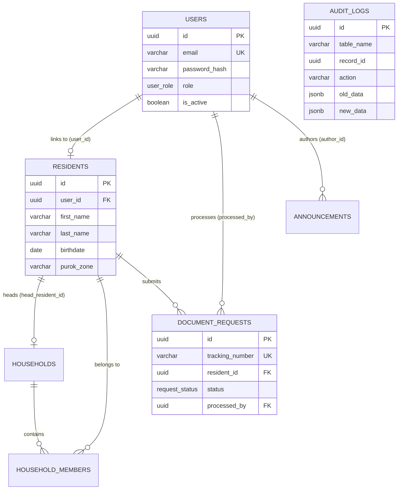

# BarangayLink — Database Documentation

**Project Title:** BarangayLink: A Web-Based Barangay Digital Management System  
**Repository:** [`my-project-team-2026/Barangaylink-database-documentation`](https://github.com/my-project-team-2026/Barangaylink-database-documentation)  
**Database Management System:** PostgreSQL 14+  
**Target Schema:** `barangay`  
**Maintained by:** Database Designer / Database Administrator  

---

## 1. Overview

This repository hosts the official technical database documentation, schema designs, stored routines specifications, and architectural guidelines for **BarangayLink**. 

The system operates under the core **Advanced Database Systems (ADS)** architecture pillar of **100% Stored Logic (Zero Inline SQL Queries)**. All database transactions, mutations, and analytical extractions are encapsulated in PostgreSQL Stored Procedures (`sp_*`) and User-Defined Functions (`fn_*`).

👉 **For the complete technical specification, please refer to [`DATABASE.md`](./DATABASE.md).**

---

## 2. Quick Navigation

* **[DATABASE.md](./DATABASE.md)** — Comprehensive technical document covering all schema objects, tables, triggers, functions, and procedures:
  * [Section 4: Database Schema (`barangay`)](./DATABASE.md#4-database-schema)
  * [Section 5: Database Tables (`users`, `residents`, `document_requests`, etc.)](./DATABASE.md#5-database-tables)
  * [Section 6: Entity-Relationship Diagram](./DATABASE.md#6-entity-relationship-diagram)
  * [Section 7: ENUM Types (`user_role`, `request_status`, `civil_status`)](./DATABASE.md#7-enum-types)
  * [Section 8: Database Indexes](./DATABASE.md#8-database-indexes)
  * [Section 9: Database Triggers](./DATABASE.md#9-database-triggers)
  * [Section 10: Database Functions](./DATABASE.md#10-database-functions)
  * [Section 11: Stored Procedures](./DATABASE.md#11-stored-procedures)
  * [Section 12: Dashboard Analytics Function](./DATABASE.md#12-dashboard-analytics-function)
  * [Section 15: Data Integrity & Security Considerations](./DATABASE.md#15-data-integrity-and-security-considerations)
  * [Section 17: Testing and Validation Checklist](./DATABASE.md#17-testing-and-validation-checklist)

---

## 3. Core Database Objects Summary

### 3.1 Tables
| Table Name | Description | Primary Key |
|---|---|---|
| `users` | User credentials, password hashes, and access roles (`user_role`). | `id` (UUID) |
| `residents` | Citizen demographics (names, birthdates, purok/zone, address, contact). | `id` (UUID) |
| `households` | Family units, household numbers, and designated heads of family. | `id` (UUID) |
| `household_members`| Association table linking residents to households with relationship titles. | `id` (UUID) |
| `document_requests`| Resident clearance and certificate applications, tracking numbers, and lifecycle statuses. | `id` (UUID) |
| `announcements` | Community notices and bulletin broadcasts with priority pinning. | `id` (UUID) |
| `audit_logs` | Immutable audit trail automatically populated by status transition triggers. | `id` (UUID) |

---

### 3.2 Functions & Stored Procedures Catalog

| Routine Name | Type | Volatility | Primary Purpose |
|---|:---:|:---:|---|
| `fn_calculate_age` | Function | `STABLE` | Computes resident age dynamically from birthdate and current date. |
| `fn_generate_tracking_number` | Function | `VOLATILE` | Generates sequential tracking numbers (e.g. `BRGY-YYYYMM-0001`). |
| `fn_get_user_password_hash` | Function | `STABLE` | Safely retrieves stored bcrypt password hash by UUID for verification. |
| `fn_get_user_profile` | Function | `STABLE` | Returns full user profile joined with resident demographics (omits password hash). |
| `fn_get_dashboard_analytics` | Function | `STABLE` | Aggregates system metrics (residents, households, request status counts). |
| `sp_register_resident_user` | Procedure | — | Atomically inserts user account and linked resident demographic profile. |
| `sp_change_user_password` | Procedure | — | Updates password hash and updates `updated_at = CURRENT_TIMESTAMP`. |
| `sp_update_request_status` | Procedure | — | Manages document request status transitions and invokes audit trigger. |

---

## 4. Entity-Relationship Overview

---

## 5. Security & Verification Standards

1. **Zero Credential Exposure:** Routines that return user profile details (`fn_get_user_profile`) deliberately omit `password_hash`. Password hashes are only queryable via dedicated verification routines (`fn_get_user_password_hash`).
2. **Pre-Hashed Inputs:** Database procedures (`sp_change_user_password`, `sp_register_resident_user`) never accept plain-text passwords. All hashing is performed via bcrypt in the Node.js application layer.
3. **Outer Join Resiliency:** `fn_get_user_profile` leverages `LEFT JOIN` so that Administrator and Staff accounts without linked resident demographics can still authenticate and query profile metadata without errors.

---

## 6. Contribution & Maintenance

All database changes must:
1. Be documented with full signatures, parameter specifications, and examples in [`DATABASE.md`](./DATABASE.md).
2. Follow PostgreSQL best practices (`STABLE` volatility on non-mutating query functions).
3. Be committed with conventional commit messages (e.g., `docs(db): ...`).
